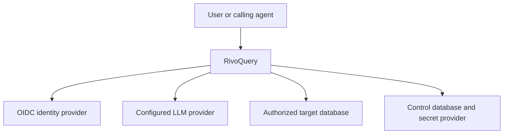
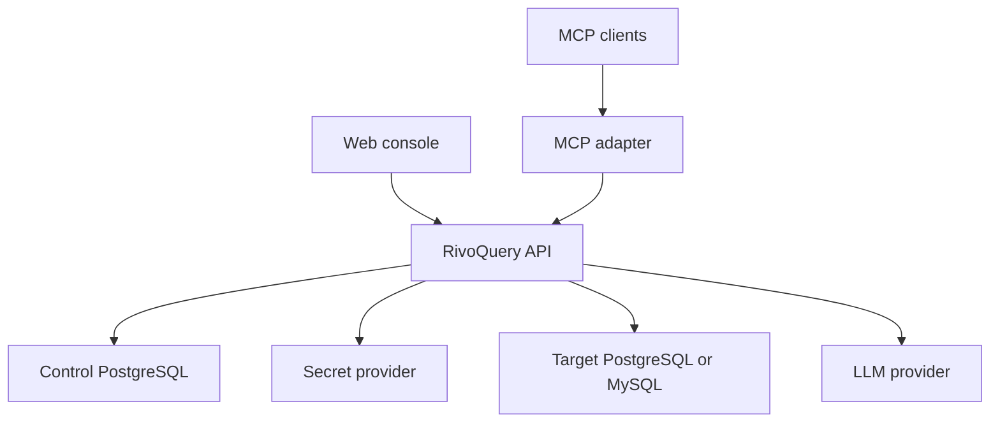
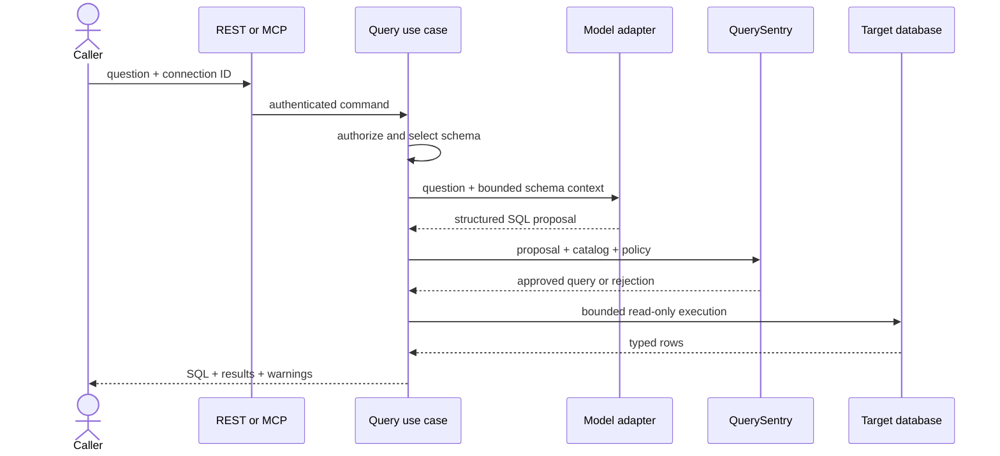
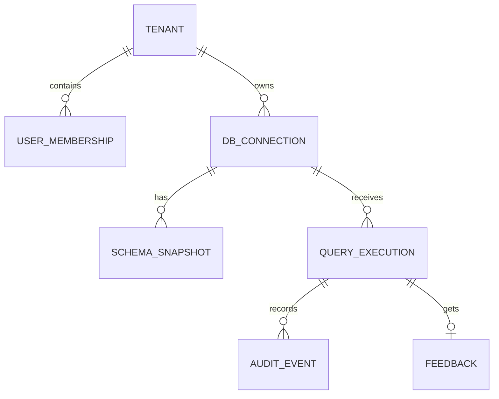

# RivoQuery architecture

## 1. Architecture goals

RivoQuery separates probabilistic interpretation from deterministic authorization. The LLM may propose SQL; it never decides whether SQL is safe or whether a caller may execute it.

The initial deployment is a modular monolith because the security transaction crosses identity, connection policy, schema, generation, validation, execution, and audit. Keeping these boundaries in one deployable unit reduces distributed failure modes while preserving interfaces that can later be extracted.

## 2. System context



Only schema metadata and the question are sent to the LLM by default. Credentials never leave the connection subsystem. Result rows flow from the target database to the caller and are not persisted in the control plane by default.

## 3. Container view



The MCP adapter may be embedded in the API process initially. It must call the same application use cases and cannot access target connectors directly.

## 4. Backend modules and dependency direction

```text
com.knowimran.rivoquery
  application/        cross-module input use-case ports and safe application errors
  identity/           caller and tenant context, authorization ports
  connection/         connection aggregate, destination policy, secret references
  catalog/            normalized schema model, discovery, snapshots, selection
  generation/         model port, prompt/context builder, structured proposal
  querypolicy/        QuerySentry parser and deterministic validation
  execution/          bounded read-only execution and result normalization
  audit/              metadata-only audit and feedback
  interfaceapi/       REST controllers and problem details
  interfacemcp/       MCP tool adapters
  platform/           configuration, persistence, telemetry, implementations
```

Rules:

- Domain/application packages do not depend on REST, MCP, JDBC-driver, LLM-provider, cloud-secret, or framework DTOs.
- REST and MCP map into the same command/query use cases.
- Connector implementations depend on the connector SPI, not on generation or HTTP.
- Query execution accepts only an `ApprovedQuery` created by QuerySentry; raw strings cannot call the executor.
- Persistence records are mapped to domain objects at the module boundary.

## 5. Core request sequence



If intent is materially ambiguous, the sequence stops after generation and returns a clarification response. If validation fails, no target connection is opened for execution.

## 6. Connection onboarding sequence

1. Authenticate, resolve the exact `X-RivoQuery-Workspace-Id` selector through
   current server-side membership, and require an active workspace
   administrator with effective `MANAGE`.
2. Validate fields and database type at the HTTP interface boundary, including
   custom cross-field checks that generated Java validation does not provide:
   reject empty connection patches and require client certificate/private-key
   material to be supplied as a pair.
3. Resolve the hostname and apply outbound destination policy to all resolved addresses.
4. Require the configured TLS mode.
5. Store the secret through `SecretStore`; persist only a secret reference and redacted metadata.
6. Test connectivity with strict timeout and a harmless metadata call.
7. Verify expected read-only capabilities and warn if the database role appears overprivileged.
8. Persist the connection as `ACTIVE` or `FAILED_VALIDATION`.
9. Trigger initial schema discovery asynchronously.

## 7. Domain model

### Main aggregates

- `Tenant`: ownership and policy boundary.
- `DatabaseConnection`: connector type, endpoint metadata, secret reference, TLS policy, object allowlist, limits, state, version.
- `SchemaSnapshot`: connection, fingerprint, normalized objects, discovery timestamp, selector index version.
- `QueryRequest`: actor, tenant, connection, question, mode, requested limits, idempotency key.
- `SqlProposal`: SQL, explanation, assumptions, referenced objects, ambiguity, model metadata.
- `ApprovedQuery`: immutable policy output containing canonical SQL, referenced objects, enforced limits, risk flags, and policy version.
- `QueryExecution`: lifecycle and timings without result-row persistence.
- `AuditEvent`: append-only security and operational metadata.
- `Feedback`: rating and optional correction linked to a request.

### Control-plane relationship sketch



All tenant-owned tables include `tenant_id`. Repository methods require tenant context, and database constraints/indexes reinforce ownership. Raw query result rows are not part of this model.

## 8. Connector SPI

```java
public interface DatabaseConnector {
    DatabaseKind kind();
    ConnectionTestResult test(ConnectionMaterial material, Duration timeout);
    SchemaCatalog discover(ConnectionMaterial material, DiscoveryPolicy policy);
    QueryResult execute(ConnectionMaterial material, ApprovedQuery query, ExecutionLimits limits);
    ConnectorCapabilities capabilities();
}
```

Implementation requirements:

- Separate driver dependency and dialect behavior.
- Hikari pools are small, keyed by active connection, bounded globally, idle-evicted, and closed on rotation/deletion.
- JDBC URLs are constructed by trusted code from validated fields. Users do not submit an unrestricted raw JDBC URL in the default API.
- Driver properties use an explicit allowlist.
- PostgreSQL and MySQL adapters have shared compatibility tests plus dialect-specific tests.

## 9. Schema context strategy

The full catalog is not placed into every prompt. The selector builds a bounded context using:

1. lexical matches across table, column, description, and synonym text;
2. key/relationship expansion around selected tables;
3. administrator-approved business concepts and join hints;
4. optional embeddings behind a selector interface when scale requires them;
5. hard budgets for tables, columns, tokens, and relationship hops.

The model sees only permitted objects. Schema comments and descriptions are quoted as untrusted data and cannot override system instructions.

## 10. Generation contract

The model adapter returns a typed structure similar to:

```json
{
  "status": "READY",
  "sql": "SELECT ...",
  "explanation": "...",
  "assumptions": ["..."],
  "referencedObjects": ["sales.orders"],
  "clarificationQuestion": null,
  "confidence": 0.82
}
```

Allowed statuses are `READY`, `NEEDS_CLARIFICATION`, and `UNANSWERABLE`. Parsing, required fields, maximum lengths, and enumeration values are deterministic. A malformed response is a provider failure, not executable SQL.

## 11. QuerySentry pipeline

1. Enforce input byte and token limits.
2. Reject NUL bytes, suspicious encoding, and unsupported dialect markers.
3. Parse exactly one statement with a bounded parser timeout.
4. Require a SELECT or WITH whose terminal operation is SELECT.
5. Walk the AST and reject DML/DDL/admin nodes, SELECT INTO, locking clauses, external access, denied functions, and unsupported constructs.
6. Resolve every referenced object against the normalized catalog and connection allowlist.
7. Reject cross-catalog/cross-database references.
8. Calculate complexity and risk limits: joins, subqueries, set operations, expression depth, selected columns, and estimated output width.
9. Apply server-owned row limit and execution policy.
10. Produce an immutable `ApprovedQuery` with policy version and SQL fingerprint.

Parser approval is necessary but not sufficient. Execution also requires caller authorization and database-level read-only credentials.

## 12. Execution controls

- Obtain credentials only immediately before connection use.
- Use a read-only DB user provisioned by the customer.
- Set JDBC `Connection#setReadOnly(true)` and a read-only transaction/session where supported.
- Set statement timeout and maximum rows at the JDBC/driver level.
- Limit response bytes while streaming; do not materialize unbounded rows.
- Normalize dates, timestamps, decimals, binary data, and vendor-specific types.
- Cancel on client disconnect or deadline.
- Close statement/result/connection resources deterministically.
- Do not expose driver messages to callers.

## 13. Identity and tenant isolation

The API validates issuer, audience, signature, expiry, and relevant claims. It maps the external subject to a membership. Every use case receives an immutable `ActorContext` with tenant and permissions.

Authorization is performed before schema/model/connector work and again at sensitive resource boundaries. MCP uses the same identity adapter or a service identity mapped to a tenant and explicit permissions.

## 14. Storage

Control PostgreSQL stores tenants, memberships, connection metadata, secret references, schema snapshots, execution metadata, audit events, feedback, and policy/prompt versions.

Credentials are handled by a `SecretStore` interface:

- Local development: AES-GCM envelope adapter with a key supplied outside source control.
- Production: managed KMS/Vault implementation or external secret broker.

No design may depend on decrypting all secrets in bulk.

## 15. API behavior

- OpenAPI 3.1 is the contract source.
- Commands support idempotency where practical.
- Errors use RFC 9457 problem details with stable `code`, `requestId`, and safe detail.
- Long schema refreshes may return an operation resource.
- Query results are synchronous only within a bounded deadline; a future async job path requires an ADR.

See `API_AND_MCP_CONTRACTS.md`.

## 16. Deployment

Initial production deployment:

- Stateless API replicas behind an ingress/API gateway.
- Web assets served separately or by a CDN.
- Managed PostgreSQL control plane.
- Managed secret/KMS service.
- Network egress policy allowing approved target database destinations and model provider endpoints.
- OpenTelemetry-compatible logs, metrics, and traces.

Target database pools are process-local. Horizontal scaling therefore multiplies possible target connections; per-connection and platform limits must account for replica count.

## 17. Failure handling

| Failure | Behavior |
| --- | --- |
| Identity provider unavailable | Existing verifiable JWTs may work; new login fails outside API |
| LLM timeout | Return provider-unavailable; never execute partial output |
| Model malformed output | Fail closed; bounded retry only for formatting if policy permits |
| Schema stale | Return warning or require refresh based on policy |
| Query rejected | Return stable policy category; no DB execution |
| Target timeout | Cancel, close resources, audit timeout |
| Result exceeds cap | Stop reading, mark truncated |
| Secret provider unavailable | Fail connection operation; do not use cached plaintext |
| Audit persistence failure | For execute requests, fail closed unless an explicit future ADR permits buffered audit |

## 18. Evolution path

- Extract MCP gateway only if independent scaling or transport isolation is demonstrated.
- Add vector schema selection behind the existing selector interface.
- Add more SQL connectors only after compatibility, safety, and normalization suites exist.
- Add deterministic charts/result summaries without sending raw rows to an LLM.
- Consider a managed execution worker tier only when connector fan-out or isolation requirements justify it.
