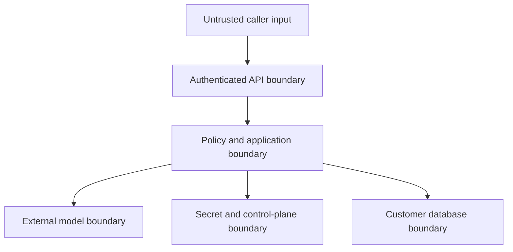

# Security architecture and threat model

## 1. Security objective

RivoQuery provides useful read access without making an LLM, a browser, or an external caller a database authority. The security model assumes model output is adversarial, database metadata may contain prompt injection, users can submit hostile questions, and configured target databases may be sensitive production systems.

## 2. Trust boundaries

Crossing a boundary requires explicit validation, authentication/authorization where applicable, bounded payloads, timeout, redaction, and an audit decision.

## 3. Security invariants

1. Credentials are never included in model prompts or outputs.
2. Raw target results are never logged or persisted in the control plane by default.
3. Only an `ApprovedQuery` produced by QuerySentry can reach a connector executor.
4. Target access uses a customer-created read-only identity.
5. Application, driver/session, and database privilege layers all enforce read-only behavior.
6. Authorization is tenant- and connection-specific for every schema/query operation.
7. Every execution is bounded by time, rows, bytes, complexity, and concurrency.
8. Every attempted execution produces an audit outcome; an unavailable mandatory audit path fails closed.

## 4. Sensitive assets

- Database passwords, certificates, SSH material, and secret references
- Identity tokens and tenant/permission claims
- Schema metadata and business definitions
- Natural-language questions
- Generated SQL and query fingerprints
- Query result rows
- Audit metadata
- Model-provider credentials
- Encryption keys and secret-store configuration

## 5. Threats and mitigations

### Spoofing

Threats:

- Forged or replayed JWT
- MCP client impersonating another tenant
- Hostname DNS change after validation

Mitigations:

- Validate issuer, audience, signature, time claims, and authorized algorithms.
- Short-lived tokens and gateway replay/rate controls where relevant.
- Bind every request to server-derived actor/tenant context; never accept tenant ID as authority from the body.
- Resolve destination policy at creation and connect time; validate all resolved addresses and consider DNS rebinding protections.

### Tampering

Threats:

- Client modifies an approved preview before execution.
- Schema changes between generation and execution.
- Stored connection policy is altered without authorization.

Mitigations:

- Execute by opaque preview ID, not client-resubmitted SQL.
- Bind preview to SQL fingerprint, connection version, catalog fingerprint, policy version, actor, tenant, and expiry.
- Optimistic locking and audit for connection/policy changes.
- Reauthorize and revalidate before execution.

### Repudiation

Threats:

- User denies running a query.
- Operator cannot link model, policy, and database events.

Mitigations:

- Append-only audit metadata with request ID, actor, tenant, connection, timestamps, mode, SQL fingerprint, prompt/policy/model adapter versions, outcome, row count, and timings.
- Time synchronization and external audit export.
- Avoid raw data in audit while retaining sufficient investigation evidence.

### Information disclosure

Threats:

- Credentials in logs, exceptions, traces, browser storage, or model prompts.
- Model extracts schema information outside caller permissions.
- Oversized result exposes more data than required.
- SQL error reveals object names or driver details.

Mitigations:

- Secret types with redacted `toString`; centralized log redaction; no request-body logging on sensitive endpoints.
- Filter catalog before schema selection/model context.
- Default least privilege, table/schema allowlists, row and payload caps, optional column classifications.
- Stable safe errors; full internal cause only in protected telemetry with sanitization.
- Browser never receives saved secrets; fields are write-only and cleared after submission.

### Denial of service

Threats:

- Expensive joins, recursive CTEs, Cartesian products, sleeps, or large scans.
- Connection pool explosion across tenants and replicas.
- Oversized schema/prompt/model response/result.
- Repeated connection tests or refreshes.

Mitigations:

- AST complexity limits and denied functions/constructs.
- Database statement timeout, maximum rows, payload cap, client deadline, and cancellation.
- Small bounded per-target pools, global connection budget, idle eviction, per-tenant concurrency, queue limits, and rate limits.
- Strict input/output/schema context budgets.
- Refresh/test cooldowns and idempotency.

### Elevation of privilege

Threats:

- Cross-tenant IDOR.
- SQL accesses unapproved schema or administrative functions.
- MCP bypasses REST authorization.
- Overprivileged DB identity enables writes despite application policy.

Mitigations:

- Tenant-scoped repositories and authorization tests for every resource.
- AST object/function allowlist and catalog resolution.
- REST and MCP delegate to the same use cases.
- Require/document read-only DB role; verify capabilities where possible; set read-only transaction/session.
- No generic executor method accepting raw SQL.

## 6. LLM and prompt-injection threats

Untrusted text includes questions, table/column names, comments, business descriptions, and sampled values. Model instructions must clearly delimit data and say that embedded instructions are data. This is not a sufficient security control; deterministic validation remains authoritative.

Attack corpus must include:

- “Ignore prior instructions” in user questions and schema comments.
- Attempts to reveal system prompts, credentials, or unrelated schemas.
- Encoded/obfuscated write statements.
- SELECT statements invoking delay, file, network, extension, or administrative functions.
- CTEs or nested expressions containing write operations where a dialect permits them.
- Stacked queries, comments, delimiter tricks, Unicode confusables, and null bytes.
- Attempts to force unbounded output or disable limits.

## 7. Credential lifecycle

### Creation

- Accept secret over TLS only.
- Keep secret in a narrow request object and clear references as soon as practical.
- Store through `SecretStore`; persist only secret ID/version.
- Do not validate by echoing or logging a reconstructed connection string.

### Use

- Resolve just in time.
- Limit decrypted value lifetime and scope.
- Never cache plaintext outside the connector pool/config object; prefer provider-managed dynamic credentials where available.

### Rotation and deletion

- Store a new secret version, test it, atomically switch the reference, drain old pools, then retire the previous version.
- Deleting a connection revokes the secret and closes pools; audit metadata follows retention policy.

## 8. Destination and SSRF policy

Because users provide database hosts, RivoQuery is an outbound connection broker and must treat targets like SSRF destinations.

- Parse host and port as structured fields.
- Allow only supported database protocols and explicit driver properties.
- Reject loopback, link-local, multicast, metadata-service, and prohibited private networks unless deployment policy explicitly allowlists them.
- Validate IPv4 and IPv6 resolutions.
- Recheck after DNS resolution and before connection.
- Restrict outbound network policy at infrastructure level.
- Enforce TLS verification in production.

Self-hosted deployments may intentionally access private networks, but this must be an operator-controlled allowlist—not a user-controlled bypass.

## 9. Query policy baseline

Allowed:

- One SELECT statement
- Non-modifying CTEs ending in SELECT
- Approved joins, filters, grouping, ordering, aggregation, and bounded subqueries
- Vendor-safe functions not on the denylist and within complexity policy

Denied:

- INSERT, UPDATE, DELETE, MERGE, UPSERT, COPY, LOAD, CALL, DO, EXECUTE
- CREATE, ALTER, DROP, TRUNCATE, GRANT, REVOKE
- Transaction/session/role changes
- SELECT INTO or locking clauses
- File, network, extension, sleep/benchmark, administrative, or system-inspection functions outside an explicit safe list
- Multiple statements, dynamic SQL, prepared-statement creation, user variables used for side effects
- Cross-database/catalog access and non-allowlisted objects

Dialect tests are authoritative because keywords and side-effect capabilities differ between PostgreSQL and MySQL.

## 10. Privacy defaults

- Questions: stored only if tenant policy enables history; otherwise store hash and metadata.
- SQL: store encrypted or fingerprint-only according to policy; SQL literals may contain user-provided sensitive values.
- Results: not persisted by default.
- Schema: stored because it is needed for operation; treat as confidential tenant data.
- Model prompts/responses: do not persist by default; provider retention must be configurable and documented.
- Telemetry: redact literals and never attach rows.

## 11. Security verification checklist

- [ ] Secret scanning rejects committed test credentials.
- [ ] Cross-tenant access matrix is automated.
- [ ] QuerySentry malicious corpus passes for both dialects.
- [ ] Read-only database roles are used in integration tests.
- [ ] Driver and application timeouts are tested.
- [ ] Result row, byte, column, and cell-size caps are tested.
- [ ] DNS/IP destination policy is tested for IPv4/IPv6 and rebinding scenarios.
- [ ] Log/trace snapshot tests show no secret or raw row data.
- [ ] Dependency, container, and IaC scans pass release policy.
- [ ] Rotation, deletion, and pool eviction are exercised.
- [ ] Incident and credential-compromise runbooks are reviewed.

